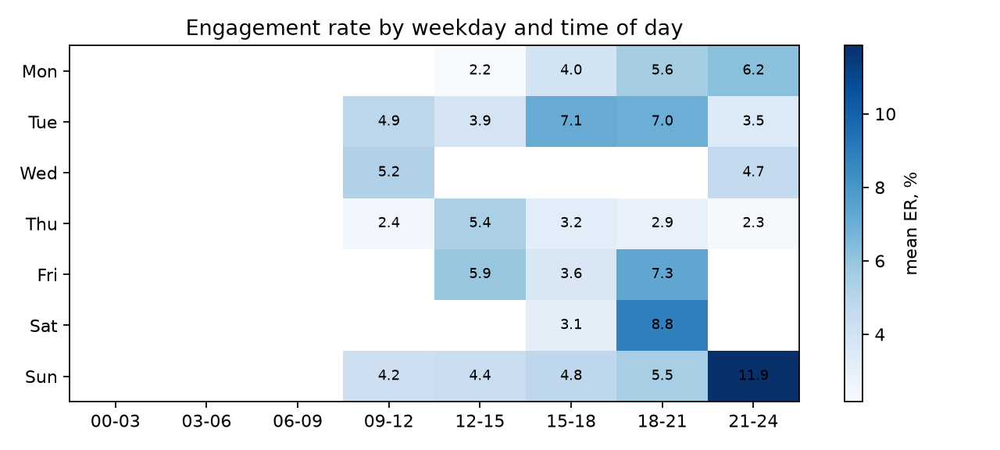

# smm-analytics-toolkit

[](https://github.com/OWNER/smm-analytics-toolkit/actions/workflows/ci.yml)
[](LICENSE)


Reproducible engagement metrics and a sentiment-classification baseline for social-media
marketing (SMM) research on Russian and Kazakh content.

The toolkit is the data-processing core of the master's thesis *"Development and Implementation
of an AI Platform for Automating Marketing Analytics and SMM"* (Astana IT University, 2026).
It turns raw Instagram/Telegram exports into anonymised, validated data, computes engagement
statistics, and evaluates sentiment classifiers on labelled comments with the same metrics for
every experiment.

## What it does

| Step | Module | Output |
|---|---|---|
| Remove personal data | `smmkit.anonymise` | e-mails, phones, @handles, URLs replaced; authors pseudonymised with a salted hash |
| Load and validate exports | `smmkit.io` | typed `Post` / `Comment` records, row-level error messages |
| Engagement metrics | `smmkit.metrics` | engagement rate by channel, format, weekday, hour; best publication slots |
| Sentiment baseline | `smmkit.sentiment` | lexicon classifier (RU/KZ, pre- and post-negation), accuracy, per-class P/R/F1, macro-F1, confusion matrix |
| Reporting | `smmkit.report`, `smmkit.viz` | markdown report, heatmap and confusion-matrix PNGs |

Any other classifier (fine-tuned transformer, LLM) can be compared with the baseline by exposing
a `predict(texts) -> list[str]` method and calling `smmkit.evaluate`.

## Installation

```bash
git clone https://github.com/OWNER/smm-analytics-toolkit.git
cd smm-analytics-toolkit
python -m venv .venv && source .venv/bin/activate
pip install -e ".[plot]"          # add ,dev for tests and linting
```

The core has **no third-party dependencies**; `matplotlib` is needed only for plots.

## Usage

```bash
smmkit report --posts data/sample/posts.csv \
              --comments data/sample/comments_labelled.csv \
              --out out --plots
smmkit metrics data/sample/posts.csv --by format
SMMKIT_SALT=change-me smmkit evaluate data/sample/comments_labelled.csv
```

From Python:

```python
from smmkit import LexiconClassifier, evaluate, load_comments, load_posts, summarise

posts = load_posts("data/sample/posts.csv")
print(summarise(posts, by="format")[0])

comments = load_comments("data/sample/comments_labelled.csv", salt="change-me")
report = evaluate([c.label for c in comments], LexiconClassifier().predict(c.text for c in comments))
print(f"macro-F1 = {report.macro_f1:.3f}")
```

### Input format

`posts.csv`: `post_id, channel, published_at (ISO 8601), format, reach, likes, comments, shares, saves`.
`comments.csv`: `comment_id, post_id, author, text`, optional `label` (`positive` / `neutral` / `negative`).

## Sample data and results

`data/sample/` is **synthetic**: post metrics come from a seeded model in
`scripts/make_sample_data.py` (reels and evening posts are given higher engagement), and the
46 comments were written for testing, including hard cases (sarcasm, mixed opinions, double
negation). Regenerate with `python scripts/make_sample_data.py`.

On this sample the lexicon baseline reaches accuracy 0.870 and macro-F1 0.869. The figure is a
smoke test, not a research result: the comments and the lexicon were written together, so it is
optimistic. Real evaluation in the thesis uses an anonymised labelled sample from the practice
base, which is not published.



## Development

```bash
pip install -e ".[dev,plot]"
ruff check . && ruff format --check .
pytest --cov=smmkit
```

Continuous integration (`.github/workflows/ci.yml`) runs on every push and pull request:
lint with ruff → tests on Python 3.9, 3.10, 3.11 and 3.12 with a 90 % coverage gate → build of
the wheel, which is installed and run on the sample data; the package and the sample report are
kept as build artifacts. Continuous delivery (`.github/workflows/release.yml`): pushing a tag
`v*` re-runs the tests, builds the package and publishes a GitHub Release with the wheel attached.

See [CONTRIBUTING.md](CONTRIBUTING.md) for the branch and commit conventions.

## Reproducibility

- Seeded sample generator and pinned minimum versions in `pyproject.toml`.
- Personal data is removed at load time; real exports are excluded by `.gitignore` (`data/raw/`).
- The pseudonymisation salt is read from `SMMKIT_SALT` and never stored in the repository.
- Cite the software with [CITATION.cff](CITATION.cff).

## License

[MIT](LICENSE) © 2026 Magzhan Zhumabayev
